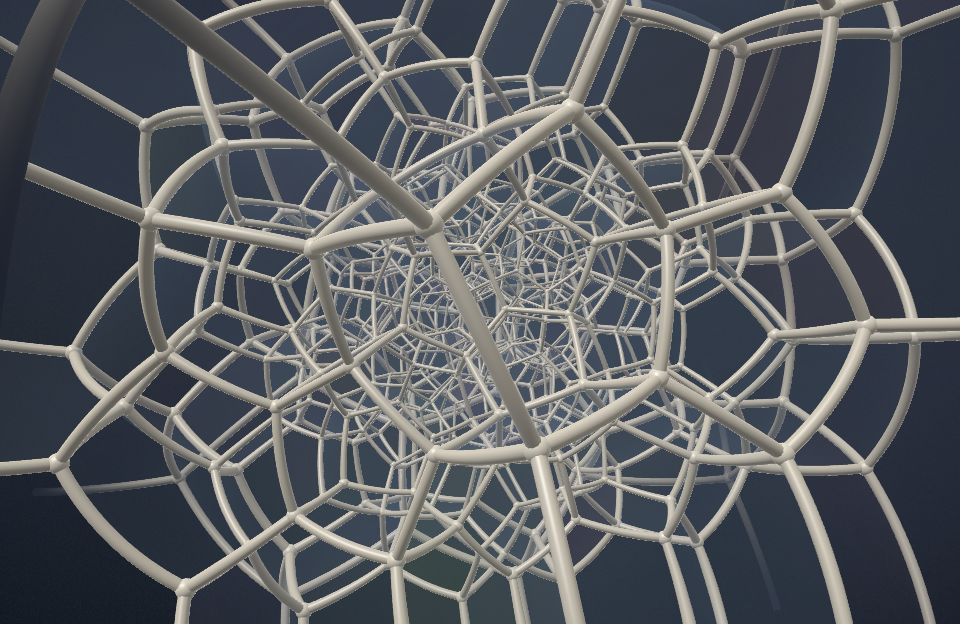

# Polychora

A macOS screensaver of the six convex regular 4-polytopes: 5-, 8-, 16-, 24-, 120- and 600-cell.
Swift + Metal, ExtensionKit `.appex` screensaver (legacy `.saver` as fallback), built without an Xcode project.



## Build and install

```sh
make test        # geometry tests (V/E/F/C counts, Euler, symmetry of the rotation)
make preview     # windowed dev harness, shader hot-reload
make install     # build Polychora.app (+ .appex) → /Applications, register with pluginkit (needs admin)
make install-legacy  # fallback: Polychora.saver → ~/Library/Screen Savers
make uninstall
```

Then pick **Polychora** in System Settings → Wallpaper → Screen Saver → Other. *Options…* opens the configure sheet.

Requires Xcode (the Makefile sets `DEVELOPER_DIR`, so `xcode-select` can stay on the CLT) and the Metal Toolchain component.
Inside Cursor's agent sandbox, SwiftPM needs `--disable-sandbox`, and anything touching the GPU (preview, snapshots, `make thumbnail`) must run unsandboxed.

Preview keys: `←/→` previous/next · `1–6` pick polytope · `0` cycle all · `p` projection mode · `t` theme · `i` info · `l` info layout · `v` fly-through · `c` clock · `+/-` speed · `space` pause · `r` reload shaders · `f` fullscreen.

Headless render, for comparing looks:

```sh
.build/release/PolychoraPreview --snapshot out.png --kind 600 --stereo 1 --time 12 --theme Ink --size 1600x1000
```

## Layout

| Path | Role |
| --- | --- |
| `Sources/PolytopeKit` | Geometry: vertex sets, edges/faces/cells, Hopf-aligned rotations, ring orbits |
| `Sources/PolychoraRender` | Metal renderer, slideshow timeline, themes, settings, overlay; `PolychoraView` is host-agnostic |
| `Shaders/Polychora.metal` | All shaders; runtime-compiled in the preview, precompiled `.metallib` in the saver |
| `Sources/PolychoraSaver` | `ScreenSaverView` subclass + options sheet; thin wrapper around `PolychoraView` |
| `Sources/PolychoraPreview` | Dev app and snapshot tool |
| `Resources/` | Saver `Info.plist`, thumbnails (`make thumbnail`) |

## Design

**Geometry.** Vertex coordinates are written out only for the 5-cell (as a regular pentagon-pair on the Clifford torus), 16-cell (±eᵢ), 8-cell ((±½)⁴), 24-cell (binary tetrahedral group 2T) and 600-cell (binary icosahedral group 2I). The 120-cell's vertices are the 600-cell's normalised cell centres. Cells are 4-cliques (simplicial cases) or the vertices maximising ⟨v, d⟩ for each dual direction d. Faces are ≥3-vertex intersections of adjacent cells.

**Projection.** One formula covers both modes: `p₃ = s.xyz · d / (d − s.w)`, where `s = mix(q, q/|q|, blend)`. With blend 0 and d = 2.2 this is the classic perspective projection of the flat polytope. With blend 1 and d = 1 it is stereographic projection of the polytope pushed onto S³: edges become circular arcs and cells become curved bubbles. Animating (d, blend) morphs one into the other. The scale factor λ = d/(d − w) also sets tube radius (conformal), capped near the pole. Geometry with large λ fades into fog.

**Motion.** Each polytope rotates by its *natural* one-parameter group: left multiplication by exp(θu) for a quaternion axis u through a vertex of 2T/2I/Q₈ (an isoclinic rotation whose orbits are Hopf circles), or the (θ, 2θ) Petrie double rotation for the 5-cell. One period maps the polytope onto itself, so rings of edges slide along themselves. Edges whose endpoints share an orbit are coloured by ring, which makes the Hopf great circles visible. A slow drift in four planes varies the view.

**Fly-through.** After each view's rotation phase (optionally only for the 120- and 600-cell), the rotation eases to a stop. The camera then travels to the projection centre, pans 360° about the vertical axis, and withdraws along the same path. Every move uses an eased trapezoidal velocity profile: accelerate, cruise, decelerate to rest. Rotation spins back up in the next phase. *Seconds per view* is the single pace dial; every phase duration scales by `holdSeconds / 30`.

**Hosting.** The default build is an ExtensionKit screensaver (`Polychora.appex`, extension point `com.apple.screensaver`), the format Apple's own savers use. It runs in its own sandboxed process. The base classes (`ScreenSaverExtension`, `ScreenSaverViewController`, `ScreenSaverConfigurationViewController`) are exported by ScreenSaver.framework but undeclared, so `Sources/ScreenSaverPrivate` declares them (after [AppexSaverMinimal](https://github.com/AerialScreensaver/AppexSaverMinimal)). The entry point is `NSExtensionMain`. `pkd` only accepts the appex when its host app sits in `/Applications` and is not marked launch-disabled, so `make install` launches the host once (with `--register-only`). Launching `Polychora.app` normally makes Polychora the screensaver on every display and space through [PaperSaver](https://github.com/AerialScreensaver/PaperSaver), which rewrites the wallpaper store, restarts WallpaperAgent and rolls back if verification fails. System Settings lists third-party extensions under "Other" with no way to add a category. The options sheet closes through the private `configureSheetDidEnd`, as Apple's savers do.

The legacy `.saver` works around `legacyScreenSaver` bugs. Rendering runs from the MTKView's own display link rather than `animateOneFrame`. Shaders load from the saver's bundle, not the host's. The process exits 1 s after `com.apple.screensaver.willstop`, because the host otherwise piles up instances.

## Background

XScreenSaver's `Polytopes` (2003) covers the same six objects but looks and moves poorly by current standards. The private `.appex` screensaver API (Aerial 4, [AppexSaverMinimal](https://github.com/AerialScreensaver/AppexSaverMinimal)) avoids the legacy host's bugs. It is the fallback if those bugs become unmanageable.
